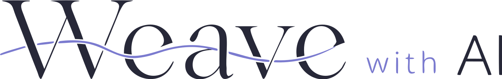

# 

An agent that turns an idea, written at any level of detail, into a website
that needs no cleanup after it is generated. Built on Meta's Muse
models.

- **For:** teams that will own and maintain the code it writes. Every screen
  reuses the design system's components instead of hand-built copies, and
  review agents argue each issue in a thread until it is fixed or explained.
- **Input:** [a ceramics studio in Jaipur, in the owner's own words](fixtures/ideas/ecommerce-store.md).
- **Output:** Jaipur Studio Ceramics, 18 screens in 2 h 20 min for $4.39, with
  0 axe violations against WCAG 2.2 AA. See [Example runs](#example-runs).
- **Scope:** the generated apps are frontend only for now. Their data lives
  in stores in the browser, behind a mock API, and sign-in is simulated.
- **Try it:** [Run it yourself](#run-it-yourself).

> The coding harness is Muse Code, Meta's coding agent. The model inside is
> Muse Spark (`muse-spark-1.3` on the Meta Model API). Every model call in a
> run goes to a Meta model.

## Built during the hackathon

The hackathon's building period ran from Oct 27 to Nov 4, 2026.

Built during the event:

- The agent, designed and built from scratch: everything outside
  `template/` and `mcps/`. That is the generator in `src/` (the pipeline,
  stage runner, validators, reviewers, rendered checks, coding engine and
  benchmark), the open-weight backends (`modal/`, `docker/`), the idea
  briefs in `fixtures/` and the docs.
- Design-system components in `template/packages/ui`: Accordion, Checkbox,
  Dialog, Image, Input, Numeral, Pagination, Popover (rebuilt), Radio,
  ScrollArea, Section, Select, SidebarMenu, Switch, Tabs, Textarea, Toast
  and Typography.
- The app components that generated screens are built from, in
  `template/web/app/components`: AppHeader, AppHeaderLeftSlot,
  AppHeaderRightSlot, AppSidebar, AppSidebarHeader, AppSidebarFooter,
  AppFooter, MarketingHeader, MarketingHeaderLeftSlot,
  MarketingHeaderRightSlot, MarketingFooter, Hero, NotFound, NextLink,
  PageHeader, PageLayout, PageLogo, UserMenu and PageErrorBoundary. PageHeader
  and PageLayout existed before only as placeholders. Also the `(app)`, `(auth)` and
  `(marketing)` route groups with the sign-in and sign-up pages.
- The `measure-design-system` and `export-design-system` tools in
  `template/tools`.
- Three new rules in the design-system MCP (`mcps/frontend`):
  - `field-width`: a field in a Form takes its width from its `width` prop,
    never from a class, so the fields of one form line up.
  - `required-prop`: a component is used with every prop its docs mark as
    required on each use.
  - `invalid-selector`: a vanilla-extract selector styles the element it
    is written on, not another one.
- The MCP's invalid-alternative rule catches more hand-built elements that
  the design system has a component for.
- Every generated app and screen shown in the demo.

Existed before the event:

- Design-system components: Avatar, Button, Card, Chip, Dropdown,
  ErrorBoundary, Form with its controller, FormControl, Icons, Link, Menu,
  Table, Tag, Tooltip and Truncate.
- Design specs for the rest of the design system. Its components were built
  from them during the event.
- Fonts, the token system, and the state and style utilities.
- The design-system MCP with all its methods (`list_components`,
  `search_components`, `get_component`, `get_recipe`, `list_tokens`,
  `search_tokens`, `validate`), its invalid-alternative rule, its form usage
  rules, and its rules on Tailwind versus vanilla-extract.
- The other scripts in `template/tools`.

The coding agent uses the MCP together with the validators and reviewers
built during the event.

## How it works

Models write specifications and code, and code checks both. Each stage
writes a JSON artifact, validated by a zod schema, with stable IDs that later
stages point to. Problems go back to the model in fix rounds. What is left
after the last round is recorded as a known issue, and the run goes on.

### The stage runner

Every stage runs on one runner, `src/runner/runSpecStage.ts`, in three
rounds:

1. The model writes a draft. Code validators check it, and reviewer calls
   look for major blockers.
2. A fix answers everything pending, and the reviewers check it again.
3. A final fix. What it leaves is recorded as known issues.

A spec stage has two reviewers. The peer reviewer challenges the decisions,
and the output reviewer finds what the validators cannot. Findings are
threads: a fix either resolves a thread or leaves it with a reason, and the
reviewer that raised it reads the reply and closes the thread or keeps it
open.

The code stages use the same runner. Their draft is a Muse Code session that
edits the app and looks up the design system through the MCP. After each
session the runner runs the app's checks (the MCP's `validate`, `typecheck`,
`lint`, `verify`) and the rendered checks in a real browser
(DESIGN-R-001 to 017). Four reviewers then read the result: code, adherence
to the design system, behavior, and UX. The UX reviewer reads a screenshot
of each route. A fix resumes the same session with the open threads.

The runner records each session's git diff in the app's ledger with its
origin, and commits it with a patch in the run. A session whose diff touches
a test or a protected path fails.

### The stages

| Stage              | Purpose                                                                                                                                                                                   |
| ------------------ | ----------------------------------------------------------------------------------------------------------------------------------------------------------------------------------------- |
| `flows-scope`      | Reads the idea and sets the app's summary, audience, roles, vocabulary and what is in and out of scope. Gaps become questions in interactive runs and assumptions otherwise.              |
| `flows-catalog`    | Lists every flow with its header and description, plus the fields and forms the flows use.                                                                                                |
| `flows-expand`     | Expands each flow into its steps. Each group of flows, by role and record, is its own call, and the groups run in parallel.                                                               |
| `design-theme`     | One call writes a design brief and the theme it becomes: every color, both page layouts and the component defaults.                                                                       |
| `design-architect` | Describes every frame, screen and dialog in prose, from the flows and the theme.                                                                                                          |
| `contract`         | Defines the records and the operations behind every screen.                                                                                                                               |
| `code-scaffold`    | Copies the template into the run, applies the theme by code, and writes the session inputs and agent config. No model call.                                                               |
| `code-contract`    | Writes the entity layer from the contract by code. One model call writes the seed rows.                                                                                                   |
| `code-frames`      | A coding session fills the frames: the headers, sidebars and footers around the pages.                                                                                                    |
| `code-pages`       | One coding session builds every screen in its route folder.                                                                                                                               |
| `bench`            | Measures the app (accessibility, keyboard, the accessibility tree, duplicated code, code quality) and the run (time, cost, rounds, what the checks and reviewers caught). No model calls. |

Each stage writes `<NN>-<group>/<NN>-<name>.json` in the run, with its
markdown beside it. The bench writes `benchmark.json` and `05-benchmark.md`.

### Models, temperature and reasoning

| Where                                            | Model                      | Temperature | Reasoning |
| ------------------------------------------------ | -------------------------- | ----------- | --------- |
| First drafts of `flows-scope` and `design-theme` | Strong (`muse-wonder-1.0`) | 0.7         | high      |
| First draft of `design-architect`                | Strong (`muse-wonder-1.0`) | 0.2         | high      |
| `flows-catalog`, `flows-expand`, `contract`      | Default (`muse-spark-1.3`) | 0.2         | medium    |
| Every fix and every reviewer                     | Default (`muse-spark-1.3`) | 0.2         | medium    |
| Coding sessions (Muse Code)                      | Default (`muse-spark-1.3`) | n/a         | medium    |

Scope, theme and architect set the app's direction, so their first drafts
run on the strong model. A better first draft leaves fewer issues for the
fixes. Scope and theme also run at 0.7 for room to be creative. Every other
call runs at 0.2 for exact values, and a fix edits only the issues it names.

The open-weight backends serve one model for every call: Muse Glimmer on
Modal, Muse Spark Open on Baseten. There, a call meant for the strong model
raises its reasoning one level instead. On Baseten the coding sessions run
OpenCode instead of Muse Code.

## Example runs

Three idea briefs from `fixtures/ideas`, each run end to end on Nov 4, 2026.
The apps were measured on their dev servers. They are frontend only, on a
mock backend in the browser. The generated apps are in
[WeaveWithAIExamples](https://github.com/avcs06/WeaveWithAIExamples).

|                                     | Jaipur Studio Ceramics                                  | SoloStudio                                                        | DashForge                                                 |
| ----------------------------------- | ------------------------------------------------------- | ----------------------------------------------------------------- | --------------------------------------------------------- |
| Idea                                | [ecommerce-store.md](fixtures/ideas/ecommerce-store.md) | [freelancer-workspace.md](fixtures/ideas/freelancer-workspace.md) | [dashboard-editor.md](fixtures/ideas/dashboard-editor.md) |
| Models and coding harness           | Muse Wonder and Muse Spark, Muse Code                   | Muse Wonder and Muse Spark, Muse Code                             | Muse Spark Open on Baseten, OpenCode                      |
| Screens                             | 18                                                      | 14                                                                | 4                                                         |
| Time                                | 2 h 20 min                                              | 1 h 40 min                                                        | 58 min                                                    |
| Cost                                | $4.39                                                   | $6.62                                                             | $8.60                                                     |
| Issues caught / fixed and rechecked | 37 / 33                                                 | 53 / 41                                                           | 129 / 101                                                 |
| Known issues                        | 4                                                       | 12                                                                | 29                                                        |
| axe violations (WCAG 2.2 AA)        | 0                                                       | 0                                                                 | 0                                                         |
| Type, lint and design-system errors | 0                                                       | 0                                                                 | 0                                                         |
| Keyboard: focus visible             | 87.9%                                                   | 98.3%                                                             | 92.2%                                                     |

A known issue is a fix from the last round, which no reviewer checks again,
or a thread a fix left open with its reason. Each run records them:

- **Jaipur Studio Ceramics:** 4 fixed in the last round. The home page
  preview hid sold-out pieces, order statuses showed raw keys, the account
  page had no signed-out state, and cancelling an order restored stock by
  piece title instead of id.
- **SoloStudio:** 11 fixed in the last round, among them dialogs that showed
  "gone" while still loading and two task filters without labels. 1 left
  open: availability times use a raw time input, because the design-system
  Input takes no `time` type.
- **DashForge:** 26 fixed in the last round, most in the planning stages. 2
  left open: a duplicate-dashboard step has no create operation behind it,
  and one flow branches from a step of another flow.

All three apps also miss a skip link, and one or two headings skip a level.

## Repository

| Path        | Contents                                                                                    |
| ----------- | ------------------------------------------------------------------------------------------- |
| `src/`      | The generator: CLI, stage runner, stages, validators, rendered checks, coding engine, bench |
| `template/` | The design-system workspace that every generated app is copied from: packages, web, tools   |
| `mcps/`     | MCP servers; `frontend` makes the design system queryable and checks code against it        |
| `modal/`    | Serving Muse Glimmer on Modal                                                               |
| `docker/`   | The container the coding sessions run in                                                    |
| `docs/`     | The benchmark spec                                                                          |
| `fixtures/` | Idea briefs and golden artifacts                                                            |

## Run it yourself

You need:

- Linux or WSL2, where it was built and tested.
- Node 24 and pnpm 10. The coding sessions run in a Node 24 container on the
  app's `node_modules`, which are installed on your machine, so the majors
  must match.
- Docker, running. The agent's image builds itself on the first coding
  session.
- Muse Code on your `PATH` as `muse`. The runner passes it your key, so it
  needs no `muse login`.
- A Meta Model API key.

Set it up once:

```sh
git clone https://github.com/avcs06/WeaveWithAI.git
cd WeaveWithAI
pnpm install                                # the generator's own dependencies
pnpm template:setup                         # install the template, build and check the MCP
pnpm exec playwright-core install chromium  # the browser for the rendered checks and screenshots
cp .env.example .env                        # then set MODEL_API_KEY
pnpm smoke                                  # one structured call to the Meta Model API
```

Write your idea in a markdown file, in as much or as little detail as you
like, and run it:

```sh
pnpm weave run my-idea.md                   # prints the run id; --interactive asks you the scope questions
pnpm weave show <runId>                     # each stage's status, rounds and known issues
pnpm --dir runs/<runId>/app dev             # the generated app at http://localhost:3001
```

A run takes 1 to 2.5 hours and costs $4 to $9, as in the example runs. It
lands in `runs/<runId>/`: the artifacts with their markdown, the generated
app with a git commit per session and round, screenshots of each round, the
event log and the benchmark.

`LLM_BACKEND` (or `--backend`) picks where calls go: `meta` (default),
`modal` or `baseten`. See `modal/README.md` for the open-weight backends.

## Commands

Run each as `pnpm weave <command>`.

```text
weave run <idea.md>          run the pipeline; --from, --to and --run resume or stop at a stage
weave session-resume <runId> <stage>
                             finish a code stage's cut session
weave validate <runId>       rerun the validators on a run's artifacts
weave show <runId>           each stage's status, rounds and known issues
weave golden <runId> <idea>  save a run's artifacts as golden fixtures
weave ds                     load the design-system inventory the agents read and print its counts
weave app <runId>            apply the run's theme to its app and screenshot every component
weave bench <runId> …        measure apps; several runs also get a side-by-side table
weave docker-clean           remove the agent's old images
```
