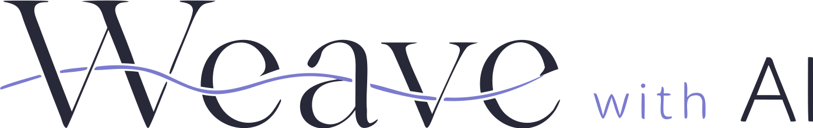

# 

An agent that turns an idea, written at any level of detail, into a website
that needs no cleanup after it is generated. Built on Claude models.

- **For:** teams that will own and maintain the code it writes. Every screen
  reuses the design system's components instead of hand-built copies, and
  review agents argue each issue in a thread until it is fixed or explained.
- **Input:** [a ceramics studio in Jaipur, in the owner's own words](fixtures/ideas/ecommerce-store.md).
- **Scope:** the generated apps are frontend only. Their data lives in
  stores in the browser, behind a mock API, and sign-in is simulated.
- **Try it:** [Run it yourself](#run-it-yourself).

> The spec stages call Claude through the Anthropic API. The coding stages
> run Claude Code headless.

## How it works

Models write specifications and code, and code checks both. Each stage
writes a JSON artifact, validated by a zod schema, with stable IDs that later
stages point to. Problems go back to the model in fix rounds. What is left
after the last round is recorded as a known issue, and the run goes on.

### The stage runner

Every stage runs on one runner, `src/runner/runSpecStage.ts`, in three
rounds:

1. The model writes a draft. Code validators check it, and reviewer calls
   look for major blockers.
2. A fix answers everything pending, and the reviewers check it again.
3. A final fix. What it leaves is recorded as known issues.

A spec stage has two reviewers. The peer reviewer challenges the decisions,
and the output reviewer finds what the validators cannot. Findings are
threads: a fix either resolves a thread or leaves it with a reason, and the
reviewer that raised it reads the reply and closes the thread or keeps it
open.

The code stages use the same runner. Their draft is a Claude Code session that
edits the app and looks up the design system through the MCP. After each
session the runner runs the app's checks (the MCP's `validate`, `typecheck`,
`lint`, `verify`) and the rendered checks in a real browser
(DESIGN-R-001 to 017). Four reviewers then read the result: code, adherence
to the design system, behavior, and UX. The UX reviewer reads a screenshot
of each route. A fix resumes the same session with the open threads.

The runner records each session's git diff in the app's ledger with its
origin, and commits it with a patch in the run. A session whose diff touches
a test or a protected path fails.

### The stages

| Stage              | Purpose                                                                                                                                                                                   |
| ------------------ | ----------------------------------------------------------------------------------------------------------------------------------------------------------------------------------------- |
| `flows-scope`      | Reads the idea and sets the app's summary, audience, roles, vocabulary and what is in and out of scope. Gaps become questions in interactive runs and assumptions otherwise.              |
| `flows-catalog`    | Lists every flow with its header and description, plus the fields and forms the flows use.                                                                                                |
| `flows-expand`     | Expands each flow into its steps. Each group of flows, by role and record, is its own call, and the groups run in parallel.                                                               |
| `design-theme`     | One call writes a design brief and the theme it becomes: every color, both page layouts and the component defaults.                                                                       |
| `design-architect` | Describes every frame, screen and dialog in prose, from the flows and the theme.                                                                                                          |
| `contract`         | Defines the records and the operations behind every screen.                                                                                                                               |
| `code-scaffold`    | Copies the template into the run, applies the theme by code, and writes the session inputs and agent config. No model call.                                                               |
| `code-contract`    | Writes the entity layer from the contract by code. One model call writes the seed rows.                                                                                                   |
| `code-frames`      | A coding session fills the frames: the headers, sidebars and footers around the pages.                                                                                                    |
| `code-pages`       | One coding session builds every screen in its route folder.                                                                                                                               |
| `bench`            | Measures the app (accessibility, keyboard, the accessibility tree, duplicated code, code quality) and the run (time, cost, rounds, what the checks and reviewers caught). No model calls. |

Each stage writes `<NN>-<group>/<NN>-<name>.json` in the run, with its
markdown beside it. The bench writes `benchmark.json` and `05-benchmark.md`.

### Models and effort

| Where                                                                | Model                         | Effort |
| -------------------------------------------------------------------- | ----------------------------- | ------ |
| First drafts of `flows-scope`, `design-theme` and `design-architect` | Strong (`claude-opus-5-5`)    | high   |
| `flows-catalog`, `flows-expand`, `contract`                          | Default (`claude-sonnet-5-5`) | medium |
| Every fix and every reviewer                                         | Default (`claude-sonnet-5-5`) | medium |
| Coding sessions (Claude Code)                                        | Default (`claude-sonnet-5-5`) | medium |

Scope, theme and architect set the app's direction, so their first drafts
run on the strong model. A better first draft leaves fewer issues for the
fixes. A call the model declines is answered again on a fallback model the
API picks.

## Repository

| Path        | Contents                                                                                    |
| ----------- | ------------------------------------------------------------------------------------------- |
| `src/`      | The generator: CLI, stage runner, stages, validators, rendered checks, coding engine, bench |
| `template/` | The design-system workspace that every generated app is copied from: packages, web, tools   |
| `mcps/`     | MCP servers; `frontend` makes the design system queryable and checks code against it        |
| `docker/`   | The container the coding sessions run in                                                    |
| `fixtures/` | Idea briefs and golden artifacts                                                            |

## Run it yourself

You need:

- Linux or WSL2, where it was built and tested.
- Node 24 and pnpm 10. The coding sessions run in a Node 24 container on the
  app's `node_modules`, which are installed on your machine, so the majors
  must match.
- Docker, running. The agent's image builds itself on the first coding
  session.
- Claude Code on your `PATH` as `claude`. The runner passes it your key, so
  it needs no login.
- An Anthropic API key.

Set it up once:

```sh
git clone https://github.com/avcs06/WeaveWithAI.git
cd WeaveWithAI
pnpm install                                # the generator's own dependencies
pnpm template:setup                         # install the template, build and check the MCP
pnpm exec playwright-core install chromium  # the browser for the rendered checks and screenshots
cp .env.example .env                        # then set ANTHROPIC_API_KEY
pnpm smoke                                  # one structured call to the Claude API
```

Write your idea in a markdown file, in as much or as little detail as you
like, and run it:

```sh
pnpm weave run my-idea.md                   # prints the run id; --interactive asks you the scope questions
pnpm weave show <runId>                     # each stage's status, rounds and known issues
pnpm --dir runs/<runId>/app dev             # the generated app at http://localhost:3001
```

A run lands in `runs/<runId>/`: the artifacts with their markdown, the
generated app with a git commit per session and round, screenshots of each
round, the event log and the benchmark.

`LLM_MODEL` and `LLM_MODEL_STRONG` pick the two models. With
`CLAUDE_AUTH=subscription` the coding sessions run on your Claude
subscription, with the token `claude setup-token` prints, instead of the key.

## Commands

Run each as `pnpm weave <command>`.

```text
weave run <idea.md>          run the pipeline; --from, --to and --run resume or stop at a stage
weave session-resume <runId> <stage>
                             finish a code stage's cut session
weave validate <runId>       rerun the validators on a run's artifacts
weave show <runId>           each stage's status, rounds and known issues
weave golden <runId> <idea>  save a run's artifacts as golden fixtures
weave ds                     load the design-system inventory the agents read and print its counts
weave app <runId>            apply the run's theme to its app and screenshot every component
weave bench <runId> …        measure apps; several runs also get a side-by-side table
weave docker-clean           remove the agent's old images
```
